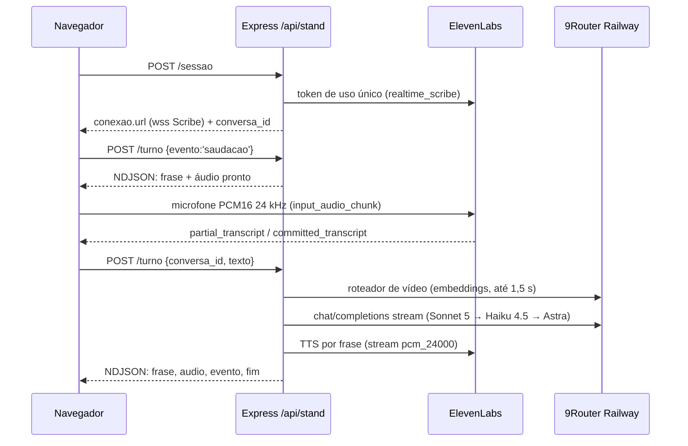
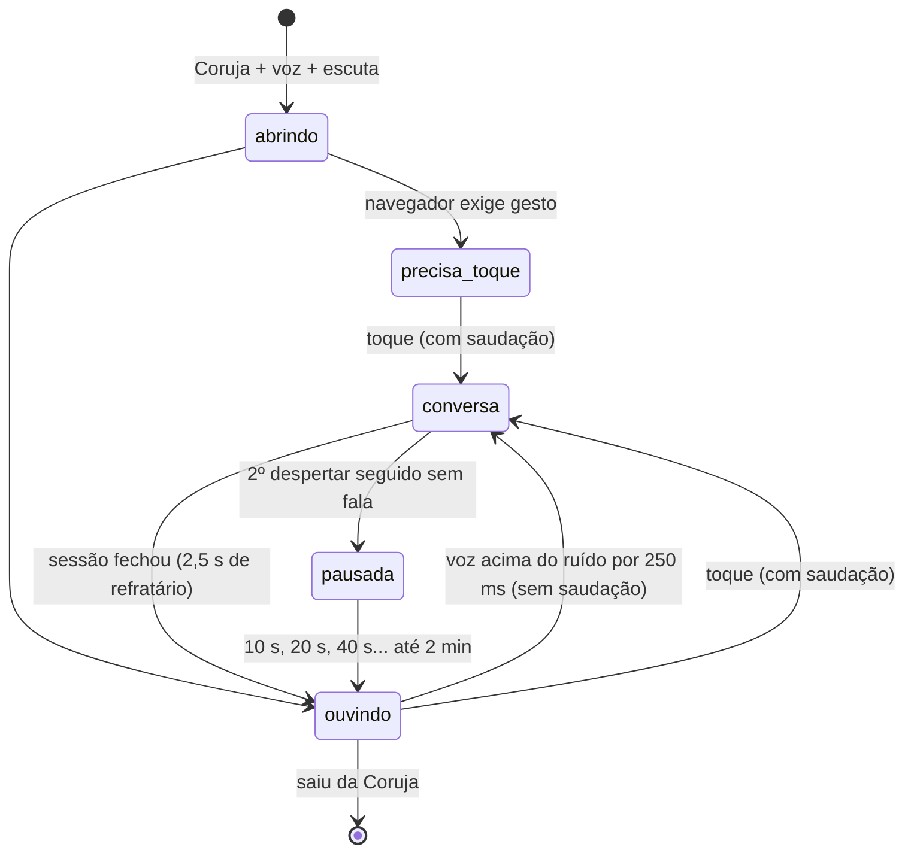

# Voz do stand

Leia ao mudar a conversa por voz do `/stand`: quem ouve, quem pensa, quem fala, limites e custo. O que a IA responde ao público está em [`stand-publico.md`](./stand-publico.md); abrir o stand numa máquina da tailnet, em [`stand-tailnet.md`](./stand-tailnet.md).

## Provedores

`STAND_VOZ_PROVEDOR` escolhe o provedor (padrão `elevenlabs`). `LUCA_STAND_VOZ` troca a voz pelo nome.

| Provedor | Ouvido | Cérebro | Voz | Credencial |
| --- | --- | --- | --- | --- |
| `elevenlabs` (padrão) | Scribe v2 Realtime, direto do navegador por token de uso único | Claude pelo 9Router Railway, no servidor | ElevenLabs TTS, voz "Lucas Oliveira", no servidor | `ELEVENLABS_API_KEY` + `ROUTER_API_KEY` |
| `xai` (reserva) | Grok Voice Realtime, tudo num WebSocket do navegador | Grok | Grok | `XAI_API_KEY` ou `XAI_OAUTH_AUTH_FILE` |

Sem a credencial do provedor escolhido, `GET /api/stand/status` responde `ligado:false` com `motivo:'sem_credencial'`, e o stand abre sem voz.

## Fluxo de um turno (`elevenlabs`)

- **Ouvido.** `server/stand/provedor-elevenlabs.js` pede o token (`POST /v1/single-use-token/realtime_scribe`) e monta a URL com `scribe_v2_realtime`, `language_code=por`, `commit_strategy=vad`, `vad_silence_threshold_secs=0.6` e `audio_format=pcm_24000`. Com o VAD padrão, a transcrição fecha ~1,7 s depois do fim da fala; com 0,6 s, ~0,7 s (medido em 19/10). `turn_prediction` não existe no realtime. A chave nunca chega ao navegador.
- **Cérebro.** `server/stand/cerebro.js` (`executarTurno`): roteador de vídeo com prazo de 1,5 s e a busca local na documentação do repo (3 trechos de até 500 caracteres) que entra só na mensagem do turno corrente. Depois vem a cadeia de modelos, com 7 s para o primeiro token. Se todos caem, sai a fala pronta de falha. Até 3 rodadas de ferramenta (`buscar_no_repo`, `pesquisar_web`, `tocar_video`, ações do site). O histórico da conversa vive na memória do Express e guarda só a pergunta e o que foi falado.
- **Tamanho da resposta.** O prompt pede no máximo três frases, e o código corta na quarta (`LIMITES_TURNO.frases`, `metricas.frases_cortadas`). Medido em 19/10 com 7 perguntas da feira: Sonnet 5 deu 1º áudio em p50 ~2,3 s (meta ≤ 3,5 s) e acertou todas. O Haiku 4.5 inventou números em 2 das 7 e não serve de primeiro modelo.
- **Voz.** O texto vira frases (`CortadorDeFrases`). Cada frase vai ao TTS em fila, com `previous_text` para manter a entonação. O áudio volta como PCM16 a 24 kHz em base64, no NDJSON. Saudação, falha e despedida são falas prontas, guardadas em cache por voz e modelo.
- **Navegador.** `src/stand-voz/sessaoTurnos.ts` toca as frases em sequência. A legenda aparece quando a frase começa a soar. `tocar_video` espera a fala que anuncia o vídeo terminar. `abrirSessaoDeVoz` escolhe entre `SessaoTurnos` e a `SessaoVoz` (xai) por `conexao.transporte`.
- **Abertura.** `abrirAudio` (`src/stand-voz/audioStand.ts`) lê o microfone por `AudioWorklet`. Se `addModule` não resolver em 2,5 s, cai para `ScriptProcessor` com a mesma reamostragem (`Bloqueador`). Em 19/10, `addModule` ficou pendente para sempre sob Playwright e a tela travou em "Ligando o microfone…". Do toque até a sessão pronta há 8 s (`PRAZO_CONEXAO_MS` em `useSessaoVoz.ts`). Passou disso, ou se o microfone ou o WebSocket falhar na abertura, a página fica 60 s no modo sem voz (`PAUSA_APOS_FALHA_MS`) e mostra o motivo em `data-motivo` no `<main>`, por exemplo `erro:sem_conexao_provedor`. `tests/stand-voz-navegador.test.js` cobre isso num Chromium real, com Scribe e turno falsos.
- **Interrupção (barge-in).** Volume alto no microfone abaixa a voz na hora. Uma transcrição parcial com 2 ou mais palavras de verdade, que não sejam eco da própria fala, corta o áudio e aborta o turno no servidor. Um turno novo da mesma conversa também aborta o anterior.
- **Eco.** Uma transcrição contida no que o LUCA acabou de falar é descartada (`pareceEco`). Durante o vídeo, o microfone manda silêncio ao Scribe.

## Escuta (conversa sem toque)

Pedido do Lucas em 19/10: o assistente fica ativo por padrão, e a pessoa só fala. Na Coruja, com voz ligada e `escuta:true` no status, `useEscuta` (`src/stand-voz/useEscuta.ts`) mantém o microfone aberto, mas o áudio fica no navegador. Só o volume é medido. Nada vai ao Scribe, e nenhum crédito é gasto, até o despertar.

- **Despertador** (`criarDespertador` em `src/stand-voz/escuta.ts`): desperta com RMS de pelo menos 3× o piso de ruído e nunca abaixo de 0,03, por 250 ms seguidos. O piso é uma média móvel do ruído. Abaixo do limiar ele anda 2 % por bloco de 50 ms; acima, 0,2 %, então barulho que fica na feira vira fundo. O piso continua aprendendo durante a pausa e entre conversas.
- **Pré-rolagem.** Os últimos 600 ms (12 blocos) antes do despertar, mais o que chegar até a sessão ficar pronta (teto de 8 s), vão ao Scribe de uma vez. Assim o começo da frase não se perde.
- **Sem saudação.** Se a sessão foi despertada pela voz, a pessoa já está falando. Por isso não há saudação, e a sessão espera a pergunta. Se em 6 s (`SEM_FALA_MS`) não chegar nenhuma transcrição, a sessão fecha como `silencio`/`sem_fala`. Um despertar falso custa ~4 créditos de STT.
- **Despertar discreto.** Enquanto não chega palavra transcrita, a sessão fica em `ocioso` e a Atração continua na tela. A Conversa só abre com a primeira transcrição que vai ao cérebro, então um despertar falso não pisca a tela. `data-escuta` já vira `conversa` no despertar.
- **Falsos seguidos.** O primeiro não pausa. Do segundo em diante, a escuta pausa por 10 s, depois 20 s e 40 s, até 2 min (`pausaAposFalsos`). Uma conversa de verdade ou um toque zera a conta. Teto de sessão, sessões por hora e teto diário seguem valendo: o despertar abre sessão pelo mesmo `POST /sessao`.
- **Um microfone só.** A sessão pega o áudio da escuta emprestado (`Emprestimo` em `sessaoTurnos.ts`) e, ao fechar, não o fecha. A escuta só fecha o microfone ao sair da Coruja. Se a conversa ainda estiver em andamento, ele fecha quando ela acabar. A Grok (`xai`) não usa empréstimo e não tem escuta.
- **Toque.** Na Atração, o toque continua abrindo a conversa com saudação, no mesmo microfone. No primeiro toque do dia, o navegador também libera o áudio (`precisa_toque`).
- **Tela.** A Atração mostra "É só falar que eu escuto." com a escuta ouvindo. Sem escuta, mostra "Toca na tela pra começar a conversa.". O estado fica em `data-escuta` no `<main>`.
- **Desligar.** `STAND_ESCUTA=0` no servidor volta ao toque, sem deploy de front. A página lê o status a cada 60 s.
- **Contagem do dia.** O navegador manda `origem:'escuta'` ou `'toque'` no `POST /sessao`. O `creditos_dia` do status traz `despertares` (sessões abertas pela escuta), `falsos` (despertares fechados sem pergunta) e `conversas` (sessões com ao menos uma pergunta, de qualquer origem). A contagem fica no mesmo arquivo do teto e zera com ele. Falsos/despertares alto pede calibrar o microfone.

O CLI tem `stand sessao` e `stand turno` (NDJSON em stdout); veja [`cli-reference.md`](./cli-reference.md).

## Limites e custo

| Limite | Valor | Onde |
| --- | --- | --- |
| Silêncio, teto de sessão, sessões por hora | 20 s, 240 s, 30 | `LIMITES_STAND` em `server/stand/rotas.js` |
| Respostas por conversa | 8 (a 9ª pergunta ouve a despedida e a sessão fecha) | `LIMITES_TURNO` em `server/stand/cerebro.js` |
| Frases por resposta | 3 (a 4ª é cortada) | idem |
| Tokens por resposta | 300 | idem |
| Caracteres de TTS por conversa | 2.000 (passou disso, a resposta sai só em legenda) | idem |
| Créditos ElevenLabs por dia | 25.000 (`STAND_TETO_DIARIO_CREDITOS`) | `server/stand/teto-diario.js` |

O teto diário soma o TTS (caracteres × 0,5 no turbo/flash, × 1 nos outros) e o STT (36 créditos por minuto de sessão aberta, medido ~35). O contador fica em `LUCA_DATA_DIR/stand/creditos-dia.json`, sobrevive a restart e zera à meia-noite de Brasília. Estourado, `status` responde `ligado:false` com `motivo:'teto_diario'`, `sessao` e `turno` respondem 503, e a equipe vê "voz pausada" no rodapé. Uma conversa fechada sem `fim` (aba fechada, queda) é cobrada pela estimativa: último turno + 20 s de silêncio + 30 s.

## Configuração

| Variável | Padrão | Para quê |
| --- | --- | --- |
| `STAND_VOZ_PROVEDOR` | `elevenlabs` | `xai` volta para a Grok Voice. |
| `ELEVENLABS_API_KEY` | vazio | Scribe e TTS. Só no ambiente do servidor. |
| `LUCA_STAND_VOZ` | `Lucas Oliveira` | Nome da voz (resolvido em `/v2/voices`, como a skill `elevenlabs-voz`) ou `voice_id`. |
| `STAND_TTS_MODELO` | `eleven_turbo_v2_5` | `eleven_multilingual_v2` soa mais rico, mas o primeiro áudio demora mais (TTFB 1,25 s contra 0,55 s). |
| `STAND_CEREBRO_MODELO` | `cc/claude-sonnet-5` | Primeiro modelo da cadeia. Aceita `cc/claude-*` ou o Astra. |
| `STAND_TETO_DIARIO_CREDITOS` | `25000` | Teto diário de créditos ElevenLabs. |
| `STAND_ESCUTA` | ligada | `0`/`false`/`off` desliga a escuta (conversa só por toque). Só vale no provedor `elevenlabs`. |
| `ROUTER_API_KEY` | vazio | 9Router Railway (cérebro e embeddings do roteador de vídeo). |

## Decisões

- [ADR 0002](./adr/0002-claude-no-cerebro-da-voz-do-stand.md): Claude no cérebro da voz do stand, exceção à regra do Astra.
- [ADR 0003](./adr/0003-escuta-por-volume-no-navegador.md): escuta por volume no navegador, sem palavra de ativação.
