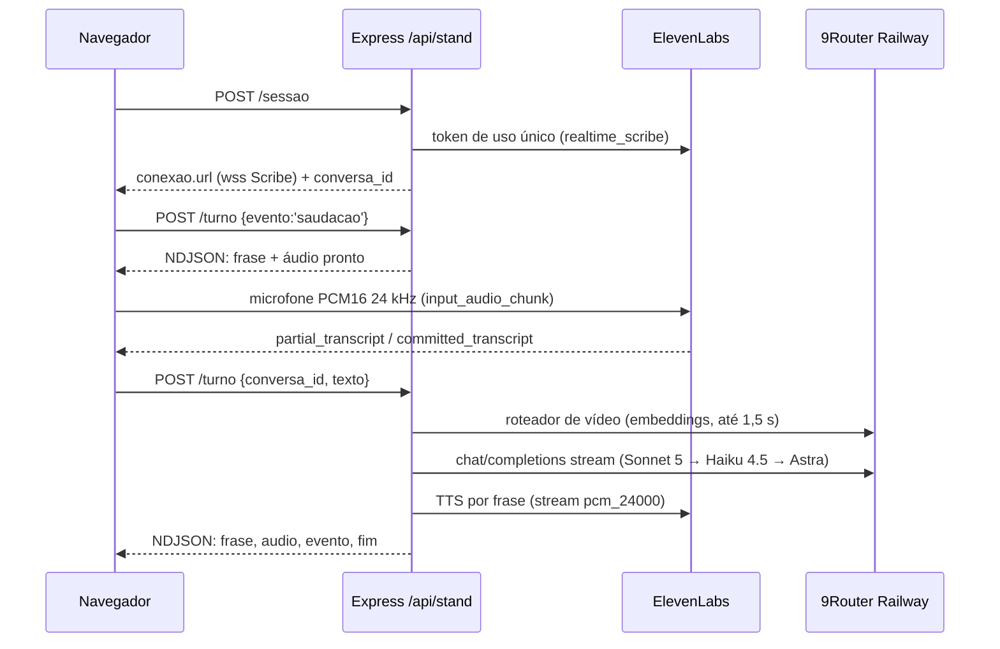

# Voz do stand

Leia ao mudar a conversa por voz do `/stand`: quem ouve, quem pensa, quem fala, limites e custo. O que a IA responde ao público está em [`stand-publico.md`](./stand-publico.md); abrir o stand numa máquina da tailnet, em [`stand-tailnet.md`](./stand-tailnet.md).

## Provedores

`STAND_VOZ_PROVEDOR` escolhe o provedor (padrão `elevenlabs`). `LUCA_STAND_VOZ` troca a voz pelo nome.

| Provedor | Ouvido | Cérebro | Voz | Credencial |
| --- | --- | --- | --- | --- |
| `elevenlabs` (padrão) | Scribe v2 Realtime, direto do navegador por token de uso único | Claude pelo 9Router Railway, no servidor | ElevenLabs TTS, voz "Lucas Oliveira", no servidor | `ELEVENLABS_API_KEY` + `ROUTER_API_KEY` |
| `xai` (reserva) | Grok Voice Realtime, tudo num WebSocket do navegador | Grok | Grok | `XAI_API_KEY` ou `XAI_OAUTH_AUTH_FILE` |

Sem a credencial do provedor escolhido, `GET /api/stand/status` responde `ligado:false` com `motivo:'sem_credencial'`, e o stand abre sem voz.

## Fluxo de um turno (`elevenlabs`)

- **Ouvido.** `server/stand/provedor-elevenlabs.js` pede o token (`POST /v1/single-use-token/realtime_scribe`) e monta a URL com `scribe_v2_realtime`, `language_code=por`, `commit_strategy=vad`, `vad_silence_threshold_secs=0.6` e `audio_format=pcm_24000`. Com o VAD padrão, a transcrição fecha ~1,7 s depois do fim da fala; com 0,6 s, ~0,7 s (medido em 19/10). `turn_prediction` não existe no realtime. A chave nunca chega ao navegador.
- **Cérebro.** `server/stand/cerebro.js` (`executarTurno`): roteador de vídeo com prazo de 1,5 s, depois a cadeia de modelos com 7 s para o primeiro token. Se todos caem, sai a fala pronta de falha. Até 3 rodadas de ferramenta (`buscar_no_repo`, `pesquisar_web`, `tocar_video`, ações do site). O histórico da conversa vive na memória do Express.
- **Voz.** O texto vira frases (`CortadorDeFrases`). Cada frase vai ao TTS em fila, com `previous_text` para manter a entonação. O áudio volta como PCM16 a 24 kHz em base64, no NDJSON. Saudação, falha e despedida são falas prontas, guardadas em cache por voz e modelo.
- **Navegador.** `src/stand-voz/sessaoTurnos.ts` toca as frases em sequência. A legenda aparece quando a frase começa a soar. `tocar_video` espera a fala que anuncia o vídeo terminar. `abrirSessaoDeVoz` escolhe entre `SessaoTurnos` e a `SessaoVoz` (xai) por `conexao.transporte`.
- **Interrupção (barge-in).** Volume alto no microfone abaixa a voz na hora. Uma transcrição parcial com 2 ou mais palavras de verdade, que não sejam eco da própria fala, corta o áudio e aborta o turno no servidor. Um turno novo da mesma conversa também aborta o anterior.
- **Eco.** Uma transcrição contida no que o LUCA acabou de falar é descartada (`pareceEco`). Durante o vídeo, o microfone manda silêncio ao Scribe.

O CLI tem `stand sessao` e `stand turno` (NDJSON em stdout); veja [`cli-reference.md`](./cli-reference.md).

## Limites e custo

| Limite | Valor | Onde |
| --- | --- | --- |
| Silêncio, teto de sessão, sessões por hora | 20 s, 240 s, 30 | `LIMITES_STAND` em `server/stand/rotas.js` |
| Respostas por conversa | 8 (a 9ª pergunta ouve a despedida e a sessão fecha) | `LIMITES_TURNO` em `server/stand/cerebro.js` |
| Tokens por resposta | 300 | idem |
| Caracteres de TTS por conversa | 2.000 (passou disso, a resposta sai só em legenda) | idem |
| Créditos ElevenLabs por dia | 25.000 (`STAND_TETO_DIARIO_CREDITOS`) | `server/stand/teto-diario.js` |

O teto diário soma o TTS (caracteres × 0,5 no turbo/flash, × 1 nos outros) e o STT (36 créditos por minuto de sessão aberta, medido ~35). O contador fica em `LUCA_DATA_DIR/stand/creditos-dia.json`, sobrevive a restart e zera à meia-noite de Brasília. Estourado, `status` responde `ligado:false` com `motivo:'teto_diario'`, `sessao` e `turno` respondem 503, e a equipe vê "voz pausada" no rodapé. Uma conversa fechada sem `fim` (aba fechada, queda) é cobrada pela estimativa: último turno + 20 s de silêncio + 30 s.

## Configuração

| Variável | Padrão | Para quê |
| --- | --- | --- |
| `STAND_VOZ_PROVEDOR` | `elevenlabs` | `xai` volta para a Grok Voice. |
| `ELEVENLABS_API_KEY` | vazio | Scribe e TTS. Só no ambiente do servidor. |
| `LUCA_STAND_VOZ` | `Lucas Oliveira` | Nome da voz (resolvido em `/v2/voices`, como a skill `elevenlabs-voz`) ou `voice_id`. |
| `STAND_TTS_MODELO` | `eleven_turbo_v2_5` | `eleven_multilingual_v2` soa mais rico, mas o primeiro áudio demora mais (TTFB 1,25 s contra 0,55 s). |
| `STAND_CEREBRO_MODELO` | `cc/claude-sonnet-5` | Primeiro modelo da cadeia. Aceita `cc/claude-*` ou o Astra. |
| `STAND_TETO_DIARIO_CREDITOS` | `25000` | Teto diário de créditos ElevenLabs. |
| `ROUTER_API_KEY` | vazio | 9Router Railway (cérebro e embeddings do roteador de vídeo). |

## Decisão: Claude no cérebro do stand (19/10/2026)

**Contexto.** Desde 18/10, todo o produto usa só o Astra (`cx/gpt-6-astra-*`), e `server/config.js` recusa outro modelo. A voz do stand responde em tempo real, e o Lucas pediu Claude/Sonnet para ela.

**Decisão.** Exceção só no cérebro do stand: `cadeiaCerebroStand` aceita `cc/claude-*`, com a cadeia Sonnet 5 → Haiku 4.5 → Astra → fala pronta. A rota `cc/` passa pelo mesmo 9Router Railway, sem conta nova. Fora do stand, a regra do Astra continua (teste em `server/config.test.js`).

**Consequências.**
- Se o p50 do primeiro áudio passar de 3,5 s, a troca para Haiku como padrão sobe ao Lucas com números.
- Retenção: o modo sem retenção da ElevenLabs (`enable_logging=false`) só existe no plano enterprise. O stand segue o padrão do provedor, aceito em 19/10.
- A Grok Voice fica como reserva por env, até alguém decidir tirá-la.
